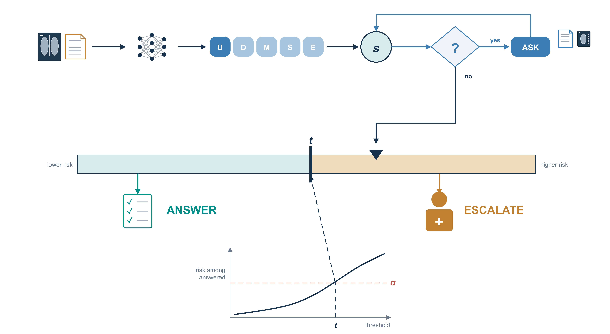
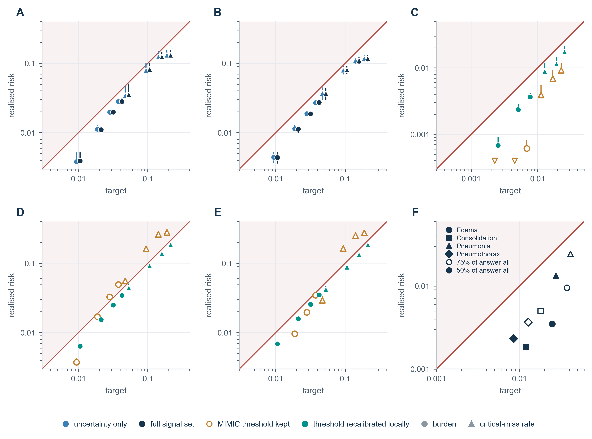
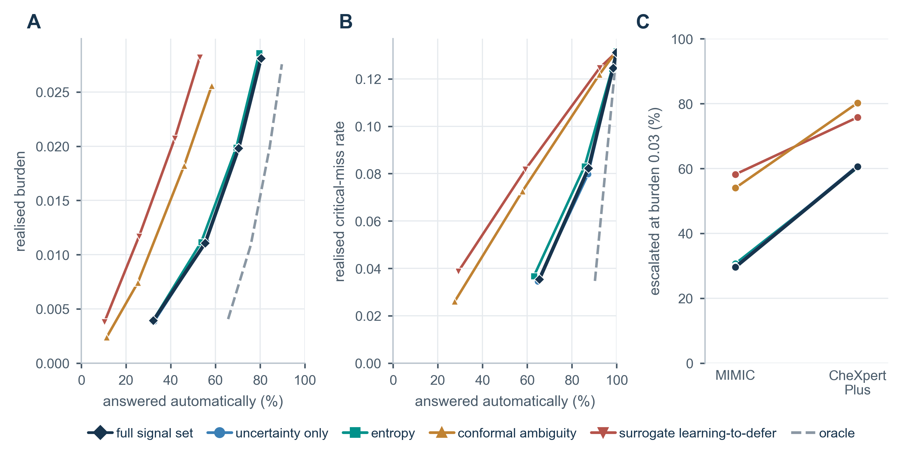
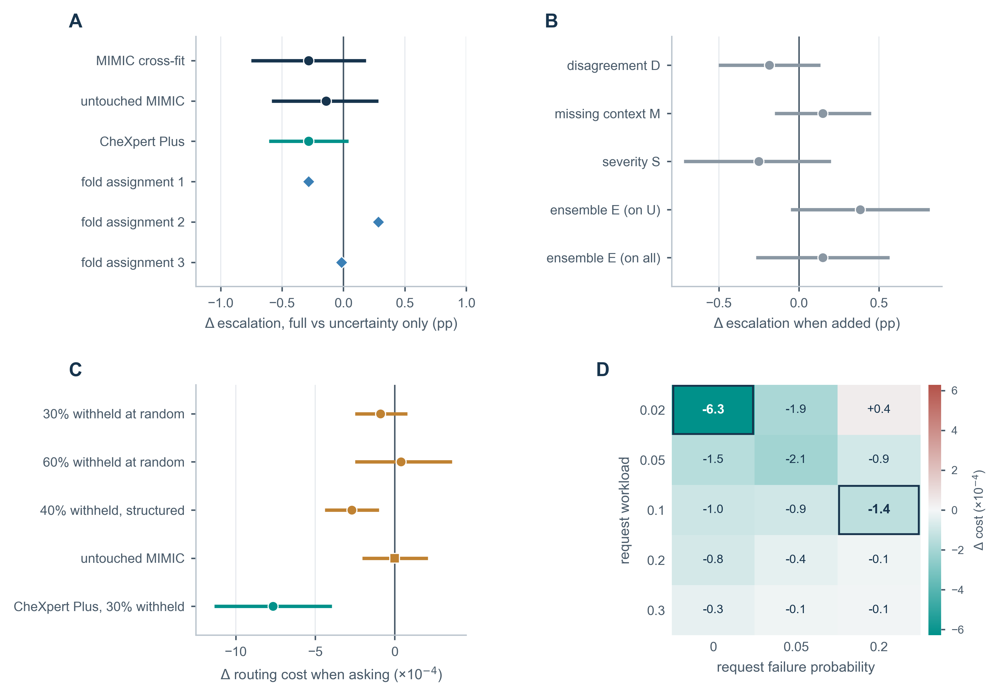
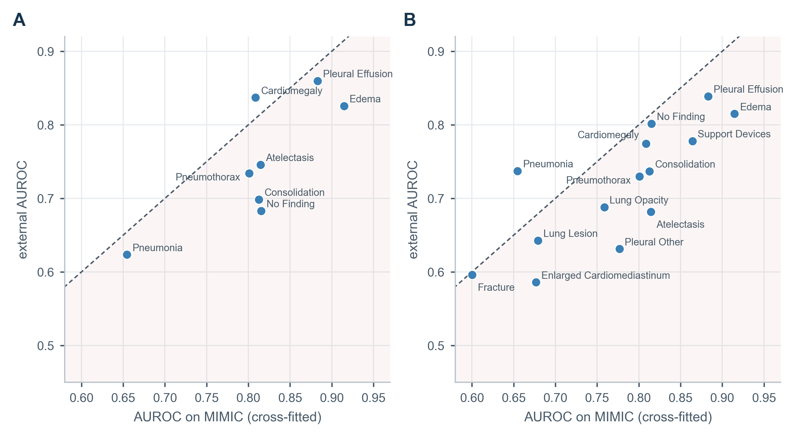

# Adaptive Risk Gate

Code, aggregate results and figures for **"Answer, ask or escalate with guaranteed limits on missed findings in chest X-ray AI"** (Abdur Rahman, 2026; manuscript in preparation for the *Journal of Biomedical Informatics*).

An oversight layer routes each chest-radiograph case to **Answer**, **Escalate** or **Ask**. The escalation threshold is calibrated with Learn-then-Test so that the severity-weighted missed-finding burden among automatically answered cases stays below a chosen target, with simultaneous bounds for four critical findings (edema, consolidation, pneumonia, pneumothorax). The study then asks whether extra routing signals or requests for more information (clinical history, a lateral view) improve on calibrated uncertainty alone.

<p align="center"></p>

## Key results

| Question | Result |
|---|---|
| Does the risk bound hold out of sample? | Met in **72/72** cross-fitted configurations (MIMIC-CXR-JPG, 5,994 patients) and **8/8** targets on 2,000 untouched MIMIC patients |
| Does it transfer to other hospitals? | NIH ChestX-ray14 (6,000 patients, image only): **6/6** with the MIMIC threshold unchanged. CheXpert Plus (6,000 patients): only **2/8** with the MIMIC threshold, **8/8** after recalibrating the threshold on 1,949 local patients |
| How many escalations are needed? | At burden target 0.03: **29.6%** (calibrated uncertainty) vs 30.7% entropy, 54.0% conformal ambiguity, 58-60% surrogate learning-to-defer |
| Do extra signals help? | Cross-modal disagreement, missing context, severity and ensemble spread: no reliable gain (primary endpoint −2.8 escalations per 1,000; 95% CI −7.5 to +1.8; Holm p = 1.0) |
| Is asking for information worth it? | History raises macro-AUROC 0.776 → 0.835, but asking for it changes routing cost negligibly; at the primary workload budget it helped only for cheap requests (about 10% of a full review or less), and more broadly only when escalation capacity was tight |
| Is it fair across subgroups? | Point target met in 77/80 MIMIC and 78/80 CheXpert Plus subgroup configurations; the guarantee is marginal, not subgroup-conditional |

Main message: finite-sample risk control gives efficient, auditable oversight, but under dataset shift the threshold should be **recalibrated on local patients** before deployment. All results are retrospective and simulated (assumed request costs, no clinicians in the loop).

## Figures

Figures 1-3 are editable **draw.io** schematics; Figures 4-8 and S1-S4 are plotted from the result tables in `results/`.

| | |
|---|---|
| <br>**Fig. 1** Cohorts and cross-fitting | <br>**Fig. 2** Embedding pipeline (frozen encoders) |
| <br>**Fig. 4** Value of history and lateral view | <br>**Fig. 5** Realised risk against target |
| <br>**Fig. 6** Risk-coverage curves | <br>**Fig. 7** Extra signals and asking |
| <br>**Fig. 8** Subgroup audit (MIMIC) | <br>**Fig. S2** Transfer of AUROC to NIH and CheXpert Plus |

Supplementary: [S1 decision curves](figures/final/FigS1_decision_curve.png), [S2 transfer of AUROC](figures/final/FigS2_transfer.png), [S3 full vs uncertainty-only gate, external](figures/final/FigS3_external_contrasts.png), [S4 CheXpert Plus subgroups](figures/final/FigS4_subgroups_chexpert_plus.png). Every figure is in `figures/final/` as vector PDF and 450-dpi PNG.

**Editing the schematics.** Open `figures/src/drawio/*.drawio` at [app.diagrams.net](https://app.diagrams.net) or in draw.io desktop, edit, then *File > Export as* PNG or PDF. `make_drawio.py` regenerates the `.drawio` files and `export_drawio.py` exports them (needs draw.io desktop and `pymupdf`).

## Repository contents

| Path | What |
|---|---|
| `notebooks/01_main_analysis.ipynb` | Full pipeline on MIMIC-CXR-JPG: embeddings, cross-fitted classifiers and gates, Learn-then-Test calibration, baselines, ask actions, per-finding bounds, NegBio second labeler, untouched cohort, NIH ChestX-ray14 |
| `notebooks/02_mimic_subgroup_audit.ipynb` | MIMIC subgroup audit (sex, age, race); reuses checkpoints from notebook 01 |
| `notebooks/03_external_chexpert_plus.ipynb` | CheXpert Plus external cohort: frozen MIMIC models with clinical history and lateral views, threshold kept vs recalibrated, baselines, ask actions, sex/age/race subgroups; reuses checkpoints from notebook 01 |
| `results/main/` | Aggregate tables (CSV), `results_v19.json`, `Results_Summary_V19.md` scorecard |
| `results/mimic_subgroups/` | MIMIC subgroup AUROC and risk tables |
| `results/external_chexpert_plus/` | CheXpert Plus tables and `results_v20_chexpert_plus.json` |
| `figures/src/make_figures.py` | Regenerates Figs. 4-8 and S1-S4 from `results/` |
| `figures/src/drawio/` | Editable draw.io sources of Figs. 1-3 and their generator/export scripts |
| `figures/final/` | All figures (PDF, PNG) |

`V19` and `V20` in file names are the internal run versions that produced the reported results.

## Data access

No patient-level data, embeddings, images or report text are included; everything in `results/` is aggregate.

- **MIMIC-CXR-JPG 2.1.0, MIMIC-CXR 2.1.0, MIMIC-IV 3.1:** credentialed access through [PhysioNet](https://physionet.org) (credentialing and data use agreement required).
- **NIH ChestX-ray14:** public.
- **CheXpert Plus:** Stanford AIMI via [Redivis](https://stanford.redivis.com/datasets/5yyj-1a9f6ap0x) under the Stanford research data use agreement. Its whole-report label file (`report_fixed.json`, v1.0) agreed with the impression labels only at chance level and was not used; see the manuscript Methods.
- **Encoders:** BiomedCLIP ViT-B/16 and BiomedBERT from Hugging Face at pinned revisions (listed in the manuscript and notebooks).

## Reproducing

1. Run `notebooks/01_main_analysis.ipynb`, then `02` and `03` (Google Colab; change `/content/drive/MyDrive/...` paths to your storage; notebook 03 asks for Redivis sign-in and a confirmation that you accept the CheXpert Plus terms).
2. Copy the aggregate outputs into `results/`.
3. Regenerate figures:

```
pip install -r requirements.txt
python figures/src/make_figures.py          # Figs. 4-8, S1-S4
python figures/src/drawio/export_drawio.py  # Figs. 1-3 (needs draw.io desktop)
```

All analysis after embedding runs on CPU. `requirements.txt` is not version-pinned; pin from your environment for exact reproduction.

## Methods at a glance

- **Classifiers:** frozen BiomedCLIP (512-d image) and BiomedBERT (768-d context, 192 tokens, mean pooling) embeddings; strongly regularised logistic regression per label with temperature scaling.
- **Outcomes:** severity-weighted missed-finding burden (targets 0.01-0.04) and critical-miss rate (0.05-0.20) among automatically answered cases. Severity weights are author-assigned, informed by the literature, and not rated by clinicians (`SEVERITY` in the notebooks).
- **Calibration:** Learn-then-Test with Hoeffding-Bentkus p-values, fixed-sequence testing, δ = 0.10; per-finding bounds with a Bonferroni split.
- **Evaluation:** six patient groups with rotating roles so every patient is evaluated once; three independent fold assignments; paired patient-level bootstrap (5,000 replicates) with Holm correction.

## Limitations

Retrospective, models developed on one source, report-derived labels from automatic labelers (CheXpert labeler for MIMIC, CheXbert for CheXpert Plus); no clinicians involved; request costs, failure rates and reviewer behaviour are assumptions with sensitivity grids; subgroup guarantees are not provided.

## Citation

Please cite the manuscript (reference to be added on publication). MIT licence; see `LICENSE`.

Author: Abdur Rahman, Independent Researcher. ORCID: [0009-0005-5495-5405](https://orcid.org/0009-0005-5495-5405)
