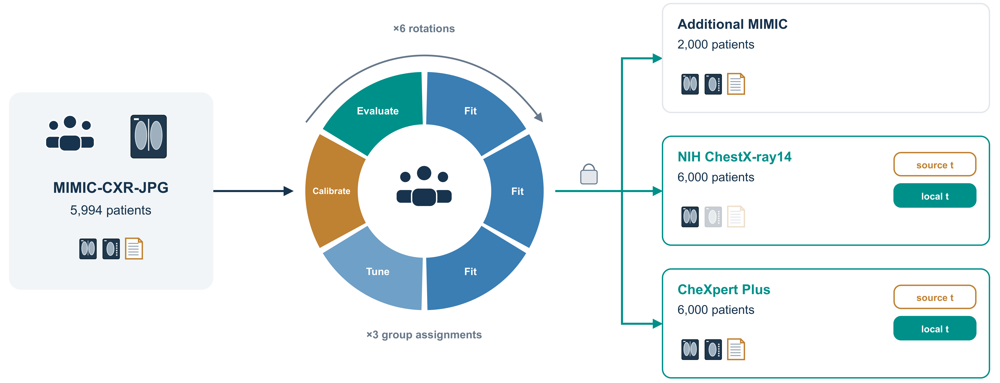
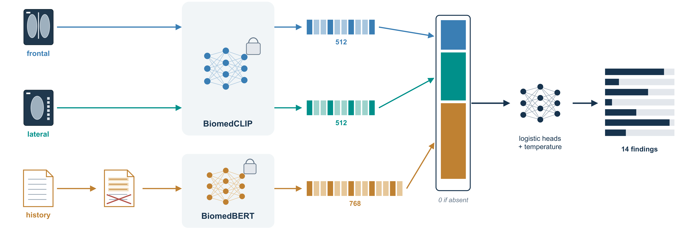
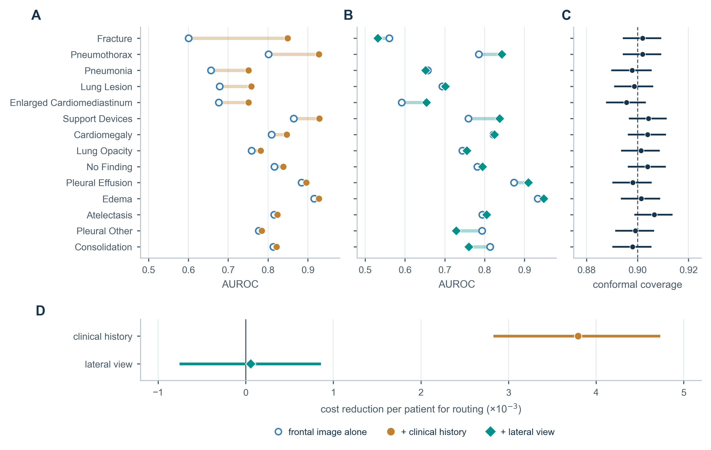
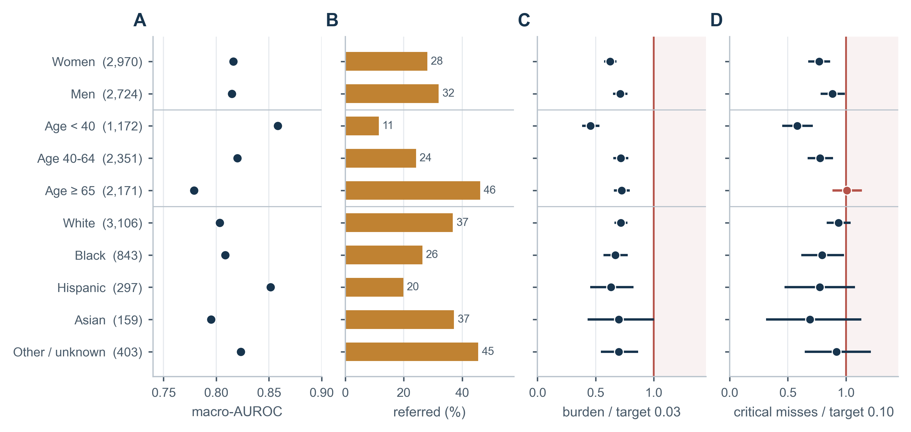

# Referral workload at specified missed-finding risk for chest radiograph AI across datasets

Code, aggregate results and figures for the manuscript submitted to SPIE’s *Journal of Medical Imaging*.

The study asks how often a chest radiograph classifier must refer patients for review to keep missed findings below a chosen target. At a calibrated risk-score threshold, the system either releases its predictions or refers the patient. A separate workload analysis allows it to request clinical history or a lateral image when eligible.

Risk is the mean unreviewed loss across **all patients entering triage**. A referred examination contributes zero unreviewed loss to this endpoint. The 201 candidate cutoffs came from the same calibration patients used to test them. The study measures how often the selected thresholds met their targets on evaluation patients. A formal finite-sample guarantee for this data-dependent procedure remains unproven.

<p align="center"></p>

**Figure 3.** A full review costs one workload unit. Under the primary assumptions, a request for history costs 0.15 units on average and a request for a lateral image costs 0.40, including review after a failed request. The policy selects actions under a mean budget of 0.30 review units per patient. [Vector PDF](figures/final/Fig3_routing.pdf) · [Editable diagram](figures/src/drawio/Fig3_routing.drawio)

## Key results

| Question | Observed result |
|---|---|
| How often were the MIMIC targets met? | **72/72** score–target combinations in each of three partitions of the same 5,994 patients. The four-signal policy met **8/8** targets in 2,000 additional MIMIC patients. |
| How did thresholds transfer? | On NIH ChestX-ray14 (6,000 patients), the four-signal policy met **6/6** exploratory targets with either calibration source. The targets were set using the NIH evaluation cohort’s answer-all risk, and the MIMIC thresholds were fitted for those targets. On CheXpert Plus with history as recorded, MIMIC thresholds met **2/8** targets. After local calibration on 1,949 patients, the policy met **8/8** targets on the same 4,051 evaluation patients. |
| How many patients were referred? | At a MIMIC burden target of 0.03, uncertainty alone referred **29.9%** and the four-signal policy referred **29.6%**. Entropy referred 30.7%, conformal ambiguity 54.0%, and the learning-to-defer surrogates 58.2% (uncertainty) and 59.9% (four signals). |
| Did additional signals change referrals? | Adding disagreement, missing-context information and severity to uncertainty changed referrals by **−2.8 per 1,000 patients** (95% CI −7.5 to 1.8, Holm-adjusted p = 1.00). The interval includes both a small reduction and a small increase. |
| What was the value of history? | Among MIMIC patients with history available, adding history increased macro-AUROC from **0.776 to 0.835**. At the primary workload budget, allowing selective history requests changed modeled diagnostic cost by **−0.00009 per patient** (95% CI −0.00025 to 0.00008). |
| How often were subgroup targets met? | Using the pooled four-signal threshold, subgroup point estimates met the target in 77/80 MIMIC and 78/80 CheXpert Plus subgroup configurations. |

## Figures

Figures 1–3 are editable draw.io diagrams. Figures 4–8 and S1–S4 use the aggregate result tables.

| | |
|---|---|
| <br>**Fig. 1** Cohorts and cross-fitting | <br>**Fig. 2** Embedding pipeline (frozen encoders) |
| <br>**Fig. 4** Value of history and lateral view | <br>**Fig. 5** Realized risk against target |
| <br>**Fig. 6** Risk-coverage curves | <br>**Fig. 7** Extra signals and asking |
| <br>**Fig. 8** Subgroup audit (MIMIC) | <br>**Fig. S1** Transfer of AUROC to NIH and CheXpert Plus |

The supplementary figures show [external AUROC](figures/final/FigS1_transfer.png) (S1), [external referral contrasts](figures/final/FigS2_external_contrasts.png) (S2), [decision curves](figures/final/FigS3_decision_curve.png) (S3) and [CheXpert Plus subgroup results](figures/final/FigS4_subgroups_chexpert_plus.png) (S4). Each figure is available as a PDF and a PNG.

## Repository contents

| Path | Contents |
|---|---|
| `notebooks/01_main_analysis.ipynb` | MIMIC classification, threshold calibration, referral and request policies, additional MIMIC patients and the NIH cohort |
| `notebooks/02_mimic_subgroup_audit.ipynb` | MIMIC subgroup evaluation using checkpoints from the main analysis |
| `notebooks/03_external_chexpert_plus.ipynb` | CheXpert Plus external evaluation, local recalibration and subgroup comparisons |
| `results/main/` | Aggregate tables, run JSON and the annotated V19 summary |
| `results/mimic_subgroups/` and `results/external_chexpert_plus/` | Aggregate subgroup and external cohort results |
| `figures/src/` and `figures/final/` | Plotting scripts, editable schematics and exported figures |
| [References](references.md) | Bibliography in manuscript citation order |
| [README checks](check_readme.py) | Checks on reported numerical results and design settings against the saved tables and notebooks |

## Reproducing the results

Run the following from the repository root to verify the reported numbers using Python’s standard library.

```sh
python check_readme.py
```

To regenerate the data plots from the included tables, install NumPy, pandas and Matplotlib, then run `python figures/src/make_figures.py`. To regenerate the editable schematics, run `python figures/src/drawio/make_drawio.py`. Open a diagram in draw.io to edit or export it. The supplied batch exporter uses draw.io Desktop on Windows and PyMuPDF.

Code and file labels follow the original analysis: escalation means referral for review, context means clinical history, and names containing “guarantee” or “ltt”, or version labels such as V13, V19 and V20, are original run identifiers. Scorecard entries that mention a guarantee report observed target attainment.

The patient-level notebooks use project-specific inputs, including `persistent_encoded_data_PRIVATE.pkl`, `frozen_manifest.json` and `config.json`. The main notebook lists the required files in its setup cells. Repeating that analysis requires authorized dataset access and the corresponding caches and checkpoints. The notebooks use Google Colab paths and the dependencies in `requirements.txt` are unpinned.

## Data access

MIMIC-CXR-JPG 2.1.0, MIMIC-CXR 2.1.0 and MIMIC-IV 3.1 require credentialed PhysioNet access. NIH ChestX-ray14 provides the image-only external cohort; the analysis notebook retrieves it from a Hugging Face mirror of the NIH Clinical Center release. CheXpert Plus is available through Stanford AIMI under its research data use agreement. The repository distributes aggregate results only.

- [MIMIC-CXR-JPG 2.1.0](https://physionet.org/content/mimic-cxr-jpg/2.1.0/) · [MIMIC-CXR 2.1.0](https://physionet.org/content/mimic-cxr/2.1.0/) · [MIMIC-IV 3.1](https://physionet.org/content/mimiciv/3.1/)
- [NIH ChestX-ray14 (NIH Clinical Center)](https://nihcc.app.box.com/v/ChestXray-NIHCC) · [Mirror used by the notebook](https://huggingface.co/datasets/alkzar90/NIH-Chest-X-ray-dataset)
- [CheXpert Plus (DOI 10.71718/6nvz-pm34)](https://doi.org/10.71718/6nvz-pm34)

## Methods at a glance

- Frozen BiomedCLIP and BiomedBERT encoders supplied image and history embeddings. Regularized logistic regression heads and temperature scaling produced finding probabilities.
- The two population endpoints were severity-weighted missed-finding burden (targets 0.01–0.04) and critical-miss rate (0.05–0.20). The severity weights (`SEVERITY` in the notebooks) were assigned without a clinician rating panel.
- Threshold selection used fixed-sequence Learn then Test with Hoeffding–Bentkus p-values and δ = 0.10. The finding-specific analysis split the error allowance across edema, consolidation, pneumonia and pneumothorax.
- In MIMIC, six patient groups rotated through fitting, tuning, calibration and evaluation. Three partitions reused the same patients. The main referral and cost comparisons used a paired patient bootstrap with 5,000 replicates and Holm adjustment where indicated.

## Limitations

All evaluations were retrospective and used report-derived labels. Request costs, failure probabilities and the effect of review on residual diagnostic loss were modeled. The subgroup estimates are descriptive. Local recalibration improved target attainment on the held-out CheXpert Plus cohort. Prospective clinical performance and the effect on patient outcomes remain open questions.

## Citation

Abdur Rahman. *Referral workload at specified missed-finding risk for chest radiograph AI across datasets.* Manuscript submitted to the *Journal of Medical Imaging*.

Department of Computer Science and Engineering, International Islamic University Chittagong, Kumira 4318, Chattogram, Bangladesh. [ORCID 0009-0005-5495-5405](https://orcid.org/0009-0005-5495-5405)

Software is distributed under the [MIT License](LICENSE).

Claude Code (Anthropic) assisted with the analysis code, and Codex (OpenAI) assisted with figure preparation and manuscript revision. The author takes responsibility for the final text.
